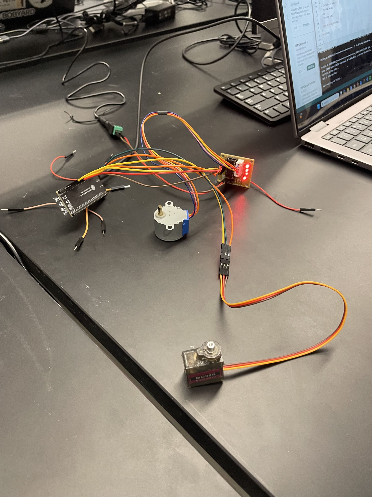

# Lab 7

## Description

In this lab, we familiarized ourselves with motors and controlling them through an ESP32. We connected both a servo and stepper motor and wrote code in the Arduino IDE to have the servo motor rotate 10 degrees every time the stepper motor rotates a full revolution.

## Video and pictures

[Video link](https://youtube.com/shorts/6oajRkP4gJE)

