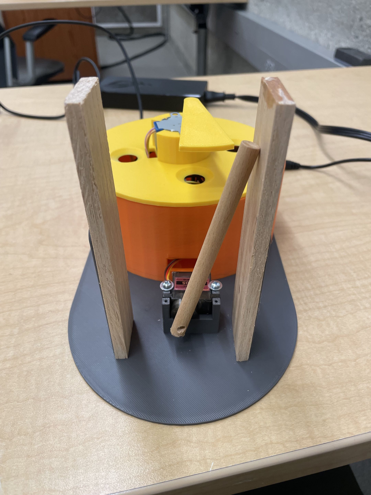
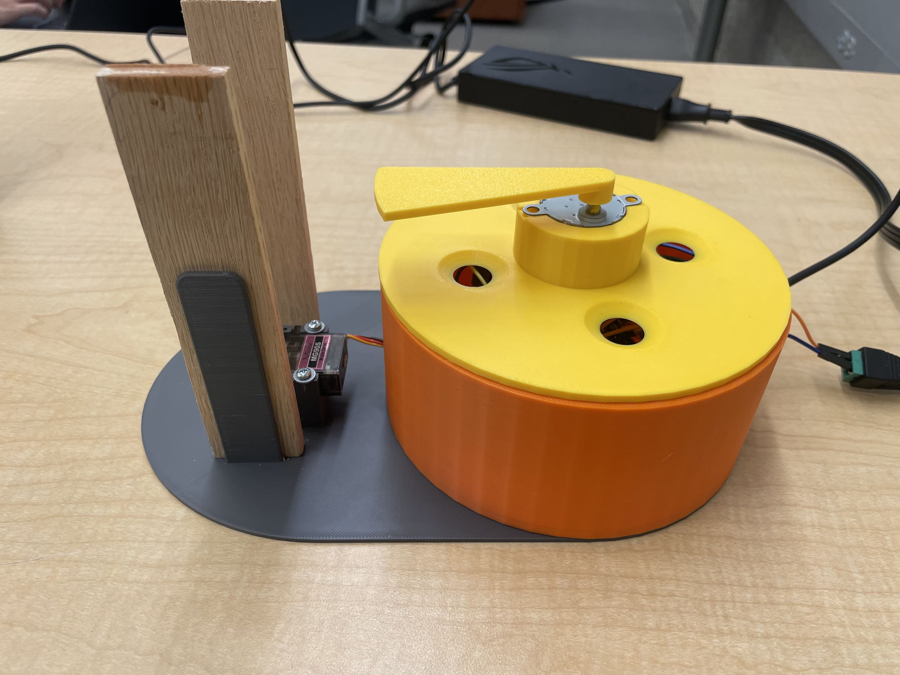

# Shadow Metronome
Author: Jonathan Zeng
## Description

The shadow metronome is a kinetic device that utilizes a stepper and servo motor to explore the interactions between light and rhythm. Specifically, the stepper motor continuously rotates a shade which will cover four sensors at a regular beat. Whenever any of these sensors detects that a shadow has passed across it, it will trigger the mini servo to spin a wooden stick to strike a wooden panel, which represents one “beat”. The observer can interact with the metronome by covering some of the sensors by placing their fingers over the holes, to create different rhythms. For example, they one hole to have it tick on the first three beats and rest on the fourth, or cover two opposite holes to halve the tempo.

## Video

[Demo Video](https://youtu.be/JXPVNtPR79U)

## How to use

For best results, first manually rotate the stepper motor shade as to not be blocking any of the holes. Then, plug in the 5V power adapter to any outlet and the USB-A cable to any power source as well. After the calibration period of three seconds, the metronome will start running. You may interact with the device by using your fingers to cover any of the holes to vary the rhythm.